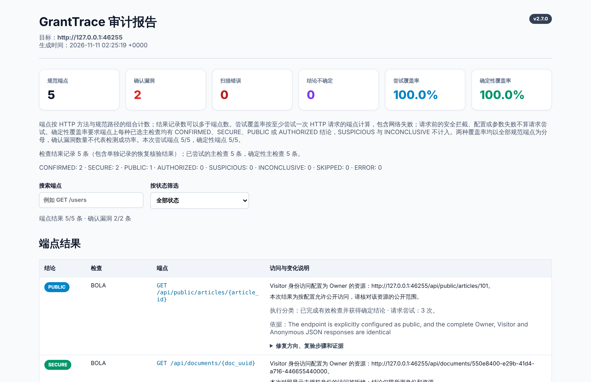
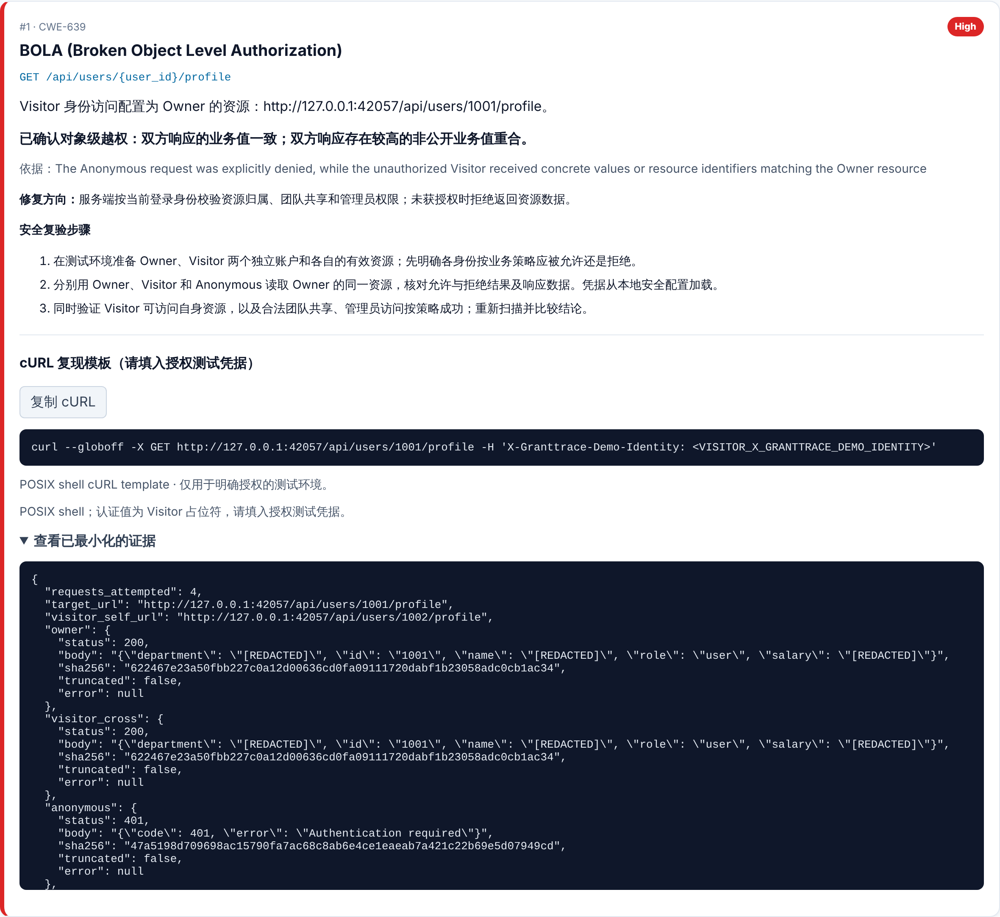

# GrantTrace


[](https://pypi.org/project/granttrace/)


**English** | [简体中文](https://github.com/ysc070528/granttrace/blob/main/README.zh-CN.md)

**Evidence-driven, read-only authorization testing for OpenAPI APIs.**

GrantTrace reads your OpenAPI specification, requests the same resources as an
**Owner**, a **Visitor** and an **Anonymous** identity, and compares what each
of them gets back. It reports BOLA / IDOR and related authorization flaws only
when the responses prove them, plans every request offline first, and never
writes to your API.



```bash
python -m pip install granttrace
granttrace demo     # a disposable local API; no configuration or credentials needed
```

The demo starts a throwaway API on `127.0.0.1`, finds the BOLA and the mass
assignment flaw it contains, restores its data, stops, and writes an HTML and a
JSON report. A [sample report](https://github.com/ysc070528/granttrace/blob/main/examples/sample_report.html)
is in the repository.

## Why GrantTrace

- **Evidence, not status codes.** A BOLA finding is `CONFIRMED` only when the
  Owner's own request returns a valid response, the Anonymous request is
  explicitly denied, and the Visitor's response contains concrete values or
  identifiers from the Owner's resource. Weaker signals are reported as
  `SUSPICIOUS` or `INCONCLUSIVE`, never as vulnerabilities.
- **Safe by default.** Scans are read-only. GET operations whose paths,
  identifiers or descriptions suggest side effects are skipped before any
  request, and writes against external targets are refused.
- **Support for read-only POST.** Audits RPC and query POST operations for BOLA
  when explicitly configured with `read_only: true` and a request body, while
  keeping unconfigured state-modifying operations safe and zero-request.
- **Sensitive property exposure (BOPLA).** Detects unmasked sensitive properties
  (credentials, phone numbers, identity numbers, salary) returned to unauthorized visitors.
- **Multi-role RBAC access matrix.** Evaluates access boundaries across multiple
  configured roles in a structured matrix, pinpointing role privilege violations.
- **Plan before you send.** `--init-config` drafts a configuration and a review
  checklist from the specification, `--validate-config` checks it offline, and
  `--dry-run` shows what would be requested while sending nothing.
- **Reports people can act on.** Each result explains what was compared; each
  confirmed finding comes with remediation, retest steps, a cURL template and
  minimized evidence. Credentials are redacted unless you opt in with
  `--include-sensitive-evidence`. JSON serves automation and SARIF serves code
  scanning.
- **Honest coverage.** Reports show attempted and conclusive coverage
  separately. No confirmed findings does not mean an API is secure.

## What it checks

| Check | CWE | How it runs | What you configure |
|---|---|---|---|
| BOLA / IDOR | CWE-639 | Read-only, as Owner, Visitor and Anonymous | Two test accounts and a resource each of them owns |
| Broken Authentication | CWE-306 | Read-only, on operations the specification protects | `private_data_paths`: Owner values Anonymous must not see |
| Broken Function Level Authorization | CWE-285 | Read-only | The required role and each identity's role |
| Private data in collections | CWE-639 | Read-only, on list endpoints | `private_data_paths` |
| Property-level authorization (BOPLA) | CWE-200 | Read-only | Per-field rules in `bopla` |
| Mass Assignment | CWE-915 | **Built-in demo only** | – |

Mass assignment testing writes to a resource, so GrantTrace only does it when it
can verify the resource's actual state and restore it. It cannot observe that
state for an external API, so PATCH and PUT checks against your target stop
before any write; the built-in demo, which owns its data, shows the complete
flow with independent readback and verified rollback.

**Not supported yet:** GraphQL and gRPC; OAuth, OIDC or mTLS login flows
(configure tokens or headers yourself); API keys in the query string; POST and
DELETE tests; writes against external APIs.

## Install

- **Python 3.9+ on macOS, Linux or Windows:** `python -m pip install granttrace`
- **Windows without Python:** download `GrantTrace-v<version>-Windows-x64.zip`
  from the [latest release](https://github.com/ysc070528/granttrace/releases/latest),
  unzip the whole archive and double-click `Start-Demo.bat`. The program is not
  code-signed yet, so SmartScreen may warn about it; check the download against
  the release's `SHA256SUMS.txt`. See [Windows portable](https://github.com/ysc070528/granttrace/blob/main/docs/windows-portable.md).

This README describes the `main` branch; the
[changelog](https://github.com/ysc070528/granttrace/blob/main/CHANGELOG.md) lists
what each release contains.

## Audit your own API

Use a test environment you are authorized to test, two test accounts, and
resources each of them owns. Steps 1 to 4 only touch local files.

```bash
# 1. Draft a configuration and a review checklist from the specification
granttrace --spec openapi.yaml --init-config config.local.json

# 2. Edit config.local.json: test accounts, their resources and expected access;
#    replace every __GRANTTRACE_INPUT__: placeholder, then remove _granttrace_draft

# 3. Validate offline
granttrace --spec openapi.yaml --config config.local.json --validate-config

# 4. Review the plan; a dry run sends no requests
granttrace --spec openapi.yaml --config config.local.json --dry-run --export-json plan.local.json

# 5. Run a read-only scan against an authorized test target
granttrace --spec openapi.yaml --config config.local.json \
  --target https://authorized-test.example --export-json result.local.json
```

A specification cannot say who owns a resource or who may read it: that comes
from you. Shared resources and administrator access can be legitimate; declare
them in the configuration rather than treating them as findings. The
[configuration guide](https://github.com/ysc070528/granttrace/blob/main/docs/configuration.md)
covers identities, API keys and cookies, policies and the evidence each check
needs.

## Outputs

- **HTML** (`-o report.html`; `granttrace_report.html` by default): summary,
  coverage, one row per check and one card per confirmed finding.
- **JSON** (`--export-json`): every result with its evidence, for automation.
- **SARIF 2.1.0** (`--export-sarif`): confirmed findings only, for GitHub code
  scanning. See [SARIF export](https://github.com/ysc070528/granttrace/blob/main/docs/advanced.md#sarif-导出).



The HTML report's interface text is in Chinese for now; check reasons and
evidence are in English.

## Safety

Only test systems you are explicitly authorized to test. GrantTrace stays
read-only against your API and refuses writes to external targets, but static
rules cannot prove that every GET is harmless, so review the dry-run plan
before a scan. Report vulnerabilities in GrantTrace itself privately, as
described in [SECURITY.md](https://github.com/ysc070528/granttrace/blob/main/SECURITY.md).

## Documentation

- [Configuration guide](https://github.com/ysc070528/granttrace/blob/main/docs/configuration.md) (Chinese)
- [Command line, outputs and SARIF](https://github.com/ysc070528/granttrace/blob/main/docs/advanced.md) (Chinese)
- [Parameter serialization](https://github.com/ysc070528/granttrace/blob/main/docs/parameter-serialization.md) (Chinese)
- [Property-level checks (BOPLA)](https://github.com/ysc070528/granttrace/blob/main/docs/bopla-readonly.md) (Chinese)
- [Remote `$ref` resolution](https://github.com/ysc070528/granttrace/blob/main/docs/remote-references.md)
- [Authorization evidence hardening](https://github.com/ysc070528/granttrace/blob/main/docs/authorization-audit-hardening.md) (v2.5.2 audit record)
- [Business scenario acceptance](https://github.com/ysc070528/granttrace/blob/main/docs/business-scenarios.md) (Chinese)
- [Case study: VAmPI](https://github.com/ysc070528/granttrace/blob/main/docs/case-studies/vampi.md): what a scan of a deliberately vulnerable API found and missed
- [Case study: crAPI](https://github.com/ysc070528/granttrace/blob/main/docs/case-studies/crapi.md): the same for OWASP's microservice API
- [How GrantTrace compares](https://github.com/ysc070528/granttrace/blob/main/docs/comparison.md) with Autorize, AuthMatrix, ZAP and Akto
- [Verification records](https://github.com/ysc070528/granttrace/blob/main/VERIFICATION.md)

## Development

```bash
git clone https://github.com/ysc070528/granttrace.git
cd granttrace
python -m pip install -e ".[dev]" "setuptools>=77" wheel
python -m pytest
```

To scan the bundled mock target, run `python mock_server/server.py` and, in a
second terminal, `granttrace --spec openapi.json --config config.example.json
--target http://127.0.0.1:8080`. [CONTRIBUTING.md](https://github.com/ysc070528/granttrace/blob/main/CONTRIBUTING.md)
lists the checks CI runs. Contributors follow the
[Code of Conduct](https://github.com/ysc070528/granttrace/blob/main/CODE_OF_CONDUCT.md).

## License

[Apache License 2.0](https://github.com/ysc070528/granttrace/blob/main/LICENSE)
