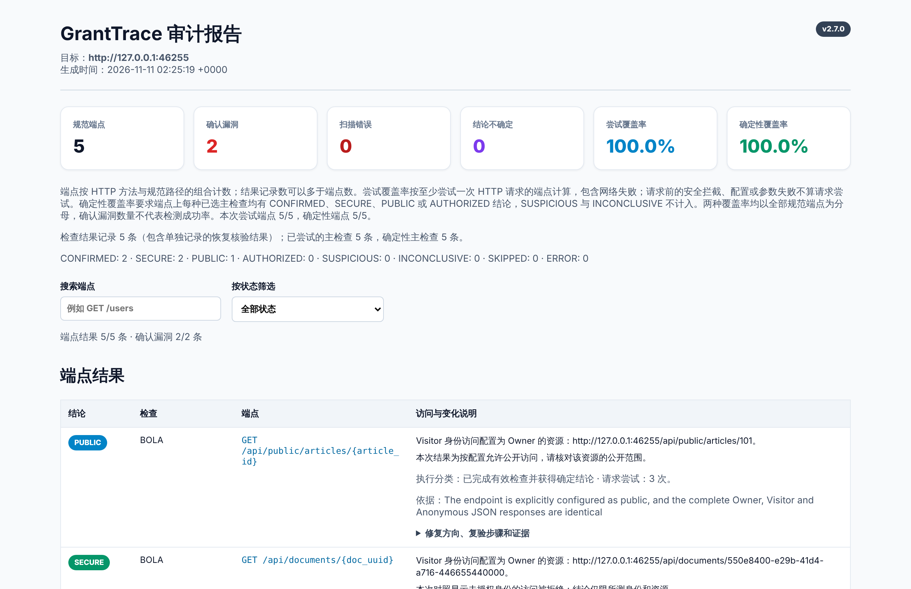
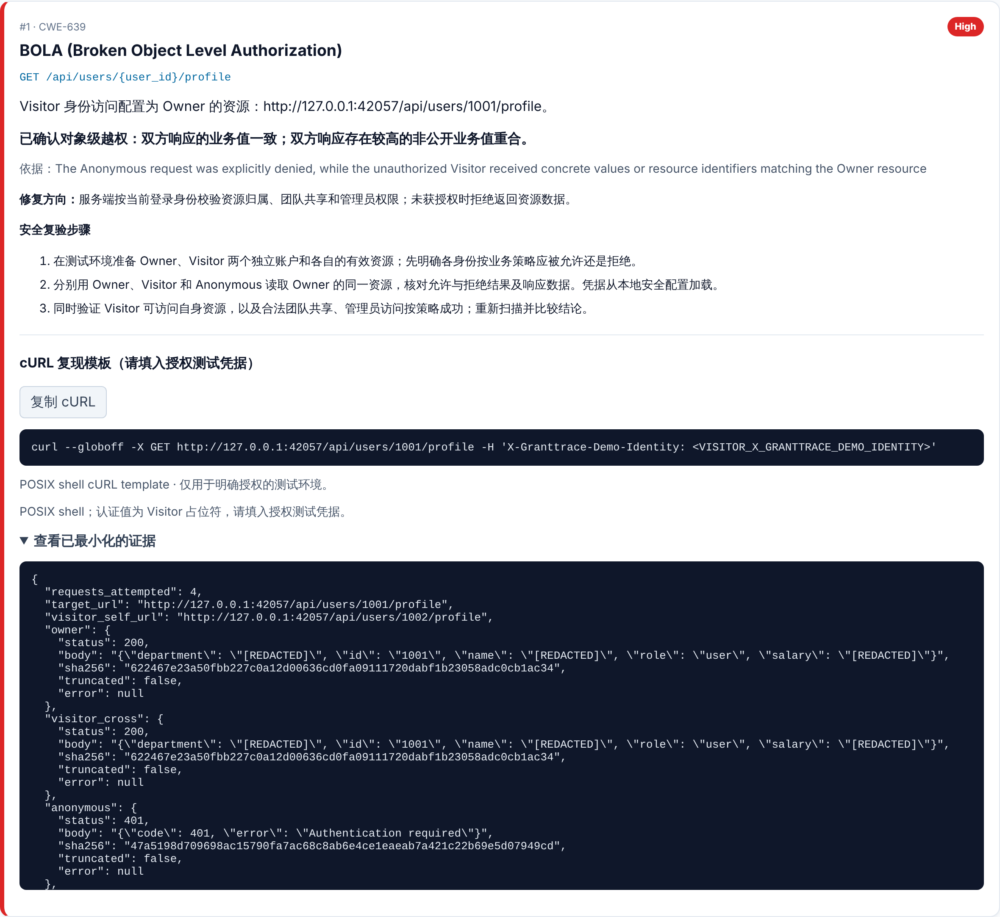

# GrantTrace


[](https://pypi.org/project/granttrace/)


[English](https://github.com/ysc070528/granttrace/blob/main/README.md) | **简体中文**

**证据驱动、默认只读的 OpenAPI 授权测试工具。**

GrantTrace 读取 OpenAPI 规范，分别以 **Owner**、**Visitor** 和 **Anonymous** 三种身份请求同一资源，
比较各自拿到的结果。只有响应本身能证明问题时才报告 BOLA / IDOR 等授权缺陷；所有请求先离线生成计划，
扫描过程中不会对你的 API 写入。



```bash
python -m pip install granttrace
granttrace demo     # 内置可丢弃的本机 API，无需配置或凭据
```

Demo 在 `127.0.0.1` 启动一个临时 API，找出其中的 BOLA 和 Mass Assignment 缺陷，恢复数据后关闭，
并生成 HTML 和 JSON 报告。仓库中有一份[示例报告](https://github.com/ysc070528/granttrace/blob/main/examples/sample_report.html)。

## 为什么用 GrantTrace

- **看证据，不看状态码。** 只有 Owner 自身请求返回有效响应、Anonymous 请求被明确拒绝、
  且 Visitor 的响应包含 Owner 资源的具体值或标识时，BOLA 才判为 `CONFIRMED`。
  证据不足时判为 `SUSPICIOUS` 或 `INCONCLUSIVE`，不会算作漏洞。
- **默认安全。** 扫描只读。路径、operationId 或描述带有副作用语义的 GET 在请求前跳过，
  对外部目标的写入一律拒绝。
- **先计划，再发送。** `--init-config` 根据规范生成配置草稿和核对清单，`--validate-config`
  离线校验，`--dry-run` 列出将要发送的请求，但不发送任何请求。
- **报告可直接用于修复。** 每条结果说明比较了什么；每个确认漏洞附修复方向、复验步骤、
  cURL 模板和最小化证据。凭据默认脱敏（除非显式使用 `--include-sensitive-evidence`）。
  JSON 用于自动化，SARIF 用于代码扫描。
- **如实报告覆盖率。** 报告分别给出尝试覆盖率和确定性覆盖率。没有确认漏洞不代表 API 安全。

## 检查范围

| 检查 | CWE | 运行方式 | 需要配置 |
|---|---|---|---|
| BOLA / IDOR | CWE-639 | 只读，以 Owner、Visitor、Anonymous 请求 | 两个测试账号及各自拥有的资源 |
| Broken Authentication | CWE-306 | 只读，针对规范要求认证的操作 | `private_data_paths`：匿名不应看到的 Owner 数据 |
| Broken Function Level Authorization | CWE-285 | 只读 | 所需角色及各身份的角色 |
| 集合接口私有数据泄露 | CWE-639 | 只读，针对列表接口 | `private_data_paths` |
| 字段级授权（BOPLA） | CWE-200 | 只读 | `bopla` 中按字段的规则 |
| Mass Assignment | CWE-915 | **仅内置 demo** | – |

Mass Assignment 测试需要写入资源，GrantTrace 只在能核验资源实际状态并恢复时才执行。
外部 API 的实际状态无法独立观察，所以针对你的目标的 PATCH / PUT 检查会在写入前停止；
自己持有数据的内置 demo 展示完整流程，包括独立读回和已核验的恢复。

**暂不支持：** GraphQL 和 gRPC；OAuth、OIDC、mTLS 登录流程（请自行配置 token 或 header）；
查询字符串中的 API key；POST、DELETE 测试；对外部 API 的写入。

## 安装

- **Python 3.9+（macOS、Linux、Windows）：** `python -m pip install granttrace`
- **未安装 Python 的 Windows：** 从[最新 Release](https://github.com/ysc070528/granttrace/releases/latest)
  下载 `GrantTrace-v<版本>-Windows-x64.zip`，完整解压后双击 `Start-Demo.bat`。程序尚未进行代码签名，
  SmartScreen 可能提示风险；请用同一 Release 的 `SHA256SUMS.txt` 核对下载文件。
  详见 [Windows 便携包说明](https://github.com/ysc070528/granttrace/blob/main/docs/windows-portable.md)。

本文描述 `main` 分支；各版本包含的改动见 [CHANGELOG](https://github.com/ysc070528/granttrace/blob/main/CHANGELOG.md)。

## 审计自己的 API

请使用获得授权的测试环境、两个测试账号，以及它们各自拥有的资源。第 1 到 4 步只处理本地文件。

```bash
# 1. 根据规范生成配置草稿和核对清单
granttrace --spec openapi.yaml --init-config config.local.json

# 2. 编辑 config.local.json：测试账号、各自的资源和预期访问权限；
#    替换全部 __GRANTTRACE_INPUT__: 占位值，然后删除 _granttrace_draft

# 3. 离线校验
granttrace --spec openapi.yaml --config config.local.json --validate-config

# 4. 检查计划；dry-run 不发送任何请求
granttrace --spec openapi.yaml --config config.local.json --dry-run --export-json plan.local.json

# 5. 对已授权的测试目标执行只读扫描
granttrace --spec openapi.yaml --config config.local.json \
  --target https://authorized-test.example --export-json result.local.json
```

规范无法说明资源归谁、谁可以读取，这些需要你来提供。团队共享和管理员访问可能是合法的，
请在配置中声明，而不是当作漏洞。账号、API Key / Cookie、授权策略以及各项检查所需的证据见
[配置指南](https://github.com/ysc070528/granttrace/blob/main/docs/configuration.md)。

## 输出

- **HTML**（`-o report.html`，默认 `granttrace_report.html`）：汇总、覆盖率、每项检查一行、每个确认漏洞一张卡片。
- **JSON**（`--export-json`）：所有结果及证据，供自动化使用。
- **SARIF 2.1.0**（`--export-sarif`）：只包含确认漏洞，供 GitHub 代码扫描使用。
  详见 [SARIF 导出](https://github.com/ysc070528/granttrace/blob/main/docs/advanced.md#sarif-导出)。



HTML 报告的界面文字目前为中文，检查理由和证据为英文。

## 安全

只测试明确获得授权的系统。GrantTrace 对你的 API 保持只读，并拒绝对外部目标写入；
但静态规则无法证明每个 GET 都没有副作用，扫描前请核对 dry-run 计划。
GrantTrace 自身的漏洞请按 [SECURITY.md](https://github.com/ysc070528/granttrace/blob/main/SECURITY.md) 私下报告。

## 文档

- [配置指南](https://github.com/ysc070528/granttrace/blob/main/docs/configuration.md)
- [命令行、输出与 SARIF](https://github.com/ysc070528/granttrace/blob/main/docs/advanced.md)
- [参数序列化规则](https://github.com/ysc070528/granttrace/blob/main/docs/parameter-serialization.md)
- [字段级授权检查（BOPLA）](https://github.com/ysc070528/granttrace/blob/main/docs/bopla-readonly.md)
- [远程 `$ref` 解析](https://github.com/ysc070528/granttrace/blob/main/docs/remote-references.md)（英文）
- [授权证据加固](https://github.com/ysc070528/granttrace/blob/main/docs/authorization-audit-hardening.md)（英文，v2.5.2 审计记录）
- [业务场景验收](https://github.com/ysc070528/granttrace/blob/main/docs/business-scenarios.md)
- [实测案例：VAmPI](https://github.com/ysc070528/granttrace/blob/main/docs/case-studies/vampi.md)（英文）：扫描一个故意含漏洞的 API，发现了什么、漏掉了什么
- [实测案例：crAPI](https://github.com/ysc070528/granttrace/blob/main/docs/case-studies/crapi.md)（英文）：OWASP 的微服务靶场 API
- [与同类工具的对比](https://github.com/ysc070528/granttrace/blob/main/docs/comparison.md)（英文）：Autorize、AuthMatrix、ZAP、Akto
- [验收记录](https://github.com/ysc070528/granttrace/blob/main/VERIFICATION.md)（英文）

## 开发

```bash
git clone https://github.com/ysc070528/granttrace.git
cd granttrace
python -m pip install -e ".[dev]" "setuptools>=77" wheel
python -m pytest
```

扫描仓库自带的 mock 靶场：运行 `python mock_server/server.py`，在另一个终端执行
`granttrace --spec openapi.json --config config.example.json --target http://127.0.0.1:8080`。
CI 运行的全部检查见 [CONTRIBUTING.md](https://github.com/ysc070528/granttrace/blob/main/CONTRIBUTING.md)；参与贡献请遵守[行为准则](https://github.com/ysc070528/granttrace/blob/main/CODE_OF_CONDUCT.md)（英文）。

## 许可证

[Apache License 2.0](https://github.com/ysc070528/granttrace/blob/main/LICENSE)
